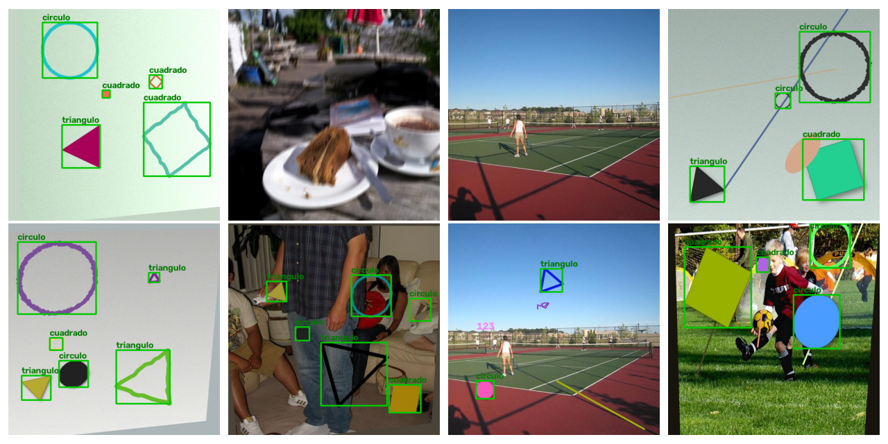
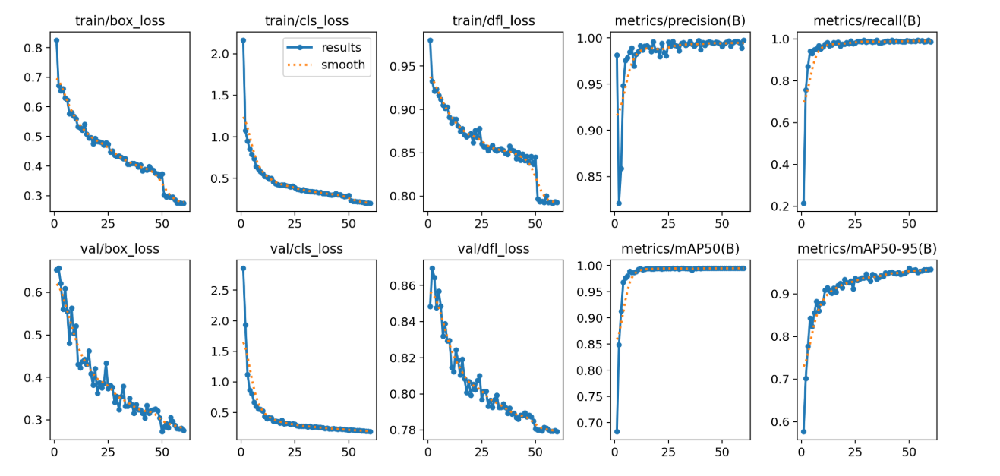
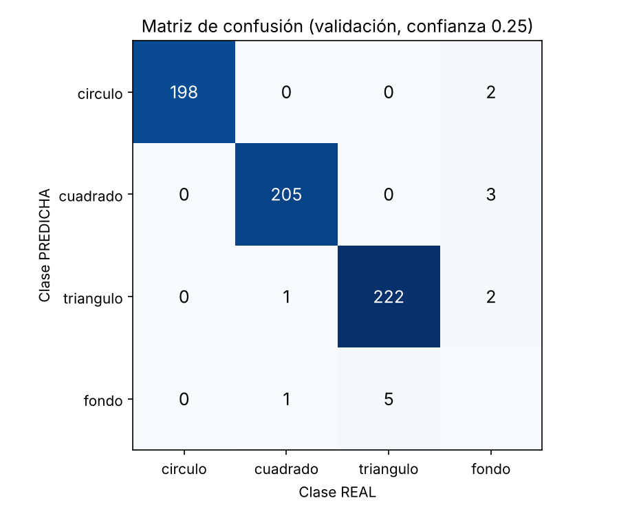
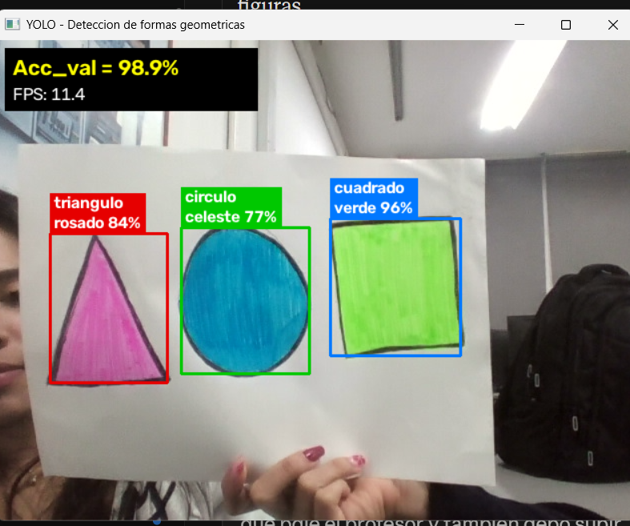
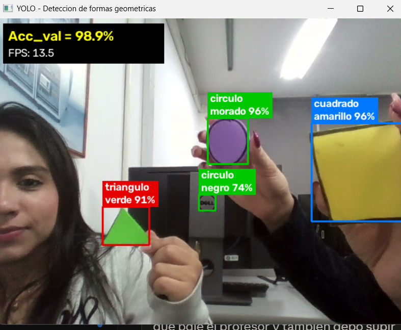

# Detección de formas geométricas con YOLOv8

Proyecto de 2° corte – Electiva IV, Deep Computer Vision  
Ingeniería Mecatrónica – Universidad Santo Tomás, Seccional Bucaramanga

**Integrantes:** Natalia Serrano Ardila y Dariana Andrea Torrecilla  
**Docente:** Ing. Carlos Daniel Pimentel Díaz, M.Sc.

El modelo detecta **círculos, cuadrados y triángulos** en video en vivo desde la webcam. En la ventana muestra al mismo tiempo:
- el bounding box,
- la figura y su color,
- la confianza,
- el **Accuracy de validación** fijo (`Acc_val = xx%`).

## Estructura

```
proyecto_yolo_formas/
├── data/
│   └── generar_dataset.py    # crea el dataset sintético en formato YOLO (70/20/10)
├── models/                   # best.pt (modelo entrenado) y metricas.json
├── docs/                     # imágenes de resultados usadas en este README
├── train.py                  # entrena YOLOv8n
├── validate.py               # mAP@0.5, precisión, recall, matriz de confusión y Accuracy_val
├── demo_webcam.py            # detección en tiempo real con la webcam
├── entrenar_en_colab.ipynb   # mismo flujo, listo para Google Colab (GPU gratis)
├── requirements.txt
└── README.md
```

## 1. Instalación

```bash
pip install -r requirements.txt
```

## 2. Preparación de datos

```bash
# 1) Descargar 128 fotos reales (COCO128) para usar como fondo
#    https://github.com/ultralytics/assets/releases/download/v0.0.0/coco128.zip  -> descomprimir aquí
# 2) Generar el dataset
python data/generar_dataset.py --n 1200 --fondos coco128/images/train2017
```

- Crea `data/formas/` con `images/` y `labels/`, divididos en train (840), val (240) y test (120), más el archivo `data.yaml`.
- Cada imagen tiene un `.txt` con una línea por figura: `clase x_centro y_centro ancho alto`, normalizado entre 0 y 1.
- Las clases son `0 = circulo`, `1 = cuadrado`, `2 = triangulo`.
- Con `--semilla 42`, que es el valor por defecto, siempre se genera el mismo dataset, así que los resultados se pueden reproducir.

## 3. Entrenamiento

```bash
python train.py                  # imgsz=640, epochs=60, batch=16, early stopping (patience=15)
python train.py --batch 8        # si la GPU se queda sin memoria
```

- Parte de `yolov8n.pt`, preentrenado en COCO (transfer learning).
- El mejor modelo se copia a `models/best.pt`.
- Las gráficas de pérdidas y mAP quedan en `runs/detect/formas/`.
- **Sin GPU** es lento. Lo más fácil es entrenar en Colab con `entrenar_en_colab.ipynb` (unos 20–30 min con GPU T4).

## 4. Validación y métricas

```bash
python validate.py
```

- Imprime mAP@0.5, mAP@0.5:0.95, precisión y recall, globales y por clase.
- Guarda dos matrices de confusión en `runs/detect/validacion/`: la de YOLO (`confusion_matrix.png`, que cuenta predicciones desde confianza 0.001) y la nuestra (`matriz_confusion_conf025.png`, con confianza 0.25, la misma del Accuracy_val).
- Calcula el **Accuracy_val**: una figura del ground truth cuenta como correcta si alguna predicción la empareja con **IoU ≥ 0.5** y además con la **clase correcta**. Accuracy_val = correctas / total de figuras en validación.
- Guarda todo en `models/metricas.json`.

## 5. Demo en tiempo real

```bash
python demo_webcam.py              # webcam 0
python demo_webcam.py --camara 1   # si tienes otra cámara
python demo_webcam.py --fuente data/formas/images/test/img_0545.jpg   # probar con una imagen
```

Para salir, presiona `q` o `ESC`. La detección la hace YOLO; OpenCV solo abre la cámara, dibuja y estima el color dentro de cada caja (con el tono HSV).

**Consejos para la cámara:**
- Funciona con figuras dibujadas con marcador en hoja blanca y con figuras recortadas en cartulina.
- Usa buena luz.
- Si salen detecciones falsas, sube la confianza mínima: `python demo_webcam.py --conf 0.7`.
- Colores que reconoce: rojo, naranja, amarillo, verde, celeste, azul, morado, rosado, fucsia, negro y blanco.

## 6. Reproducir las métricas

```bash
python data/generar_dataset.py --n 1200 --fondos coco128/images/train2017   # mismo dataset (semilla 42)
python validate.py --pesos models/best.pt
```

## Dataset

El dataset es **generado artificialmente por el equipo** con `data/generar_dataset.py`. Las figuras y sus etiquetas las crea el script; lo único que viene de un repositorio abierto son 128 fotos reales que se usan **solo como fondo** (set público **COCO128** de Ultralytics, tomado de COCO).

- **Tamaño:** 1200 imágenes de 640×640, divididas en 840 train, 240 val y 120 test.
- **Clases:** 3 (`circulo`, `cuadrado`, `triangulo`), con unas 1.100 figuras por clase, equilibradas.
- **Formato:** YOLO (un `.txt` por imagen).

Cada imagen varía en:

| Variación | Para qué sirve |
|---|---|
| Fondo tipo hoja (claro u oscuro, degradado, ruido) o **foto real** (55 %) | Que funcione sobre papel y con la habitación de fondo |
| **Imágenes negativas**: fotos reales sin figuras, `.txt` vacío (~20 %) | Que no confunda caras, manos, techos u objetos con figuras |
| 1 a 6 figuras; **40 % pequeñas** (24–70 px) y el resto de 70–280 px | Detectar figuras lejos de la cámara |
| Cualquier color (incluidos rosado, celeste y negro) | Que no dependa del color |
| Contorno (recto o hecho a mano) o relleno tipo **cartulina recortada con sombra** | Figuras dibujadas o recortadas |
| **Dedos** tapando un borde (20 %) | Figuras sostenidas con la mano |
| Rotación y **perspectiva** (hoja inclinada) | Hoja girada o vista en ángulo |
| **Desenfoque de movimiento** (25 %), desenfoque normal, brillo | Cuando la hoja o la cámara se mueven |
| Distractores sin etiqueta (líneas, garabatos, texto) | Que no todo trazo sea una figura |



## Resultados

Entrenamiento en Google Colab (GPU Tesla T4): YOLOv8n, `imgsz=640`, `epochs=60`, `batch=16`, `patience=15`. Corrió las 60 épocas (el early stopping no se activó) en unos 15 minutos.



**Métricas en validación** (240 imágenes, 632 figuras):

| Clase | Precisión | Recall | mAP@0.5 | Accuracy_val |
|---|---|---|---|---|
| Círculo | 0.997 | 1.000 | 0.995 | 100 % |
| Cuadrado | 0.990 | 0.995 | 0.995 | 99.0 % |
| Triángulo | 0.985 | 0.978 | 0.994 | 97.8 % |
| **Global** | **0.991** | **0.991** | **0.995** | **98.9 %** |

mAP@0.5:0.95 = 0.961. Inferencia: 5.1 ms por imagen en GPU; en el portátil (CPU) la demo corre a 11–13 FPS.

**Matriz de confusión** (confianza 0.25). Filas = clase predicha, columnas = clase real; "fondo" en la fila son figuras no detectadas y en la columna son detecciones falsas.



**Demo en tiempo real** (figuras con marcador en hoja blanca y figuras de foami recortadas):




## Problemas encontrados y cómo se corrigieron

| Problema en la cámara | Causa | Corrección |
|---|---|---|
| La cara, la mano y objetos del fondo se detectaban como figuras | El primer dataset solo tenía fondos lisos sintéticos | Se usaron 128 fotos reales de **COCO128** como fondo y como **imágenes negativas** (sin figuras y con `.txt` vacío) |
| Las figuras pequeñas o lejanas no se detectaban | Las figuras del dataset eran grandes | El 40 % de las figuras del dataset se genera pequeña |
| Al mover la hoja se perdía la detección | El movimiento produce desenfoque | Desenfoque de movimiento en el 25 % de las imágenes |
| Las figuras de foami sostenidas con la mano fallaban | Los dedos y la sombra del recorte tapaban el borde | Se simularon dedos tapando un borde y la sombra de la figura recortada |
| El trazo de marcador negro salía "gris" y algunos colores salían mal | Se promediaba toda la caja, que es casi todo papel blanco | Se separan los píxeles oscuros de los píxeles con color y se toma el tono (H) en HSV; se agregaron rosado, fucsia y celeste |
| La matriz de confusión de YOLO mostraba muchos errores | YOLO la calcula con confianza 0.001 | Se calculó una matriz propia con confianza 0.25, la misma del Accuracy_val |

## Limitaciones y trabajo futuro

- Los triángulos deformes o poco uniformes no siempre se detectan: el dataset tenía sobre todo triángulos equiláteros. Se puede agregar triángulos isósceles, rectángulos y escalenos.
- El lado brillante del foami refleja la luz y no se detecta bien.
- El color depende de la iluminación y del tipo de marcador.
- Pueden salir detecciones falsas sobre logos u objetos redondos del fondo; se pueden reducir subiendo la confianza (`--conf 0.7`) o agregando fotos reales etiquetadas.

## Conclusiones

1. No se detectaron todos los triángulos, por sus deformidades y porque no eran uniformes.
2. Se tuvieron problemas con los colores, por ser hechos con marcadores.
3. Se usaron figuras en papel blanco y en foami recortado; el lado brillante del foami no funcionó por la luz.
4. Se agregó movimiento y sombras al dataset, y se usó COCO128 desde un link para tener imágenes negativas y de fondo.
5. Se entrenó en Colab durante 60 épocas, lo que tardó 15 minutos, y el resultado se visualizó en Visual Studio Code.
